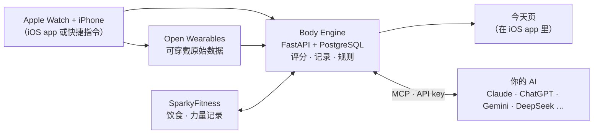

<!-- Chinese edition of README.md; keep the two in step. Links to releases / issues / actions are relative (../../…) on purpose. -->
<h1 align="center">Watch2Whoop</h1>

<p align="center">
  <b>用你已经戴着的 Apple Watch，做类似 WHOOP 的恢复、负荷和睡眠分析。</b><br>
  不用订阅，不用另买手环。数据在你自己的服务器上，任何 AI 都能通过 MCP 读写。
</p>

<p align="center">
  <a href="../../actions/workflows/ci.yml"></a>
  <a href="https://github.com/SongyuQi-Francisco/Watch2Whoop/stargazers"></a>
  <a href="LICENSE"></a>
  <a href="../../releases"></a>
  <a href="#ai-和-mcp"></a>
  <a href="apps/watch2whoop/README.md"></a>
</p>

<p align="center">
  <a href="#快速开始"><b>快速开始</b></a> ·
  <a href="docs/README.md">文档</a> ·
  <a href="docs/tester-handbook.md">使用手册</a> ·
  <a href="#路线图">路线图</a> ·
  <a href="../../releases">发布</a> ·
  <a href="apps/watch2whoop/CHANGELOG.md">更新日志</a> ·
  <a href="CONTRIBUTING.md">参与贡献</a> ·
  <a href="README.md">English</a>
</p>

<p align="center"></p>

> [!IMPORTANT]
> 与 WHOOP、Apple 无关（名称是它们的商标，只用来说明配合什么使用、像什么）。不是医疗器械，不构成医疗建议。
> 状态：**alpha**，先支持 Apple Watch。所有截图都是合成数据。

## 为什么
Apple Watch 已经在记录心率、HRV、睡眠阶段、血氧和训练，但很少把它们变成每天能用的建议。订阅制手环会做，可分析结果锁在它们的
app 里。Watch2Whoop 补上这一块，而且归你自己：

- **用手表原始数据算出类似 WHOOP 的数字**：恢复、负荷、睡眠需求和睡眠债、压力、身体年龄，都和你自己的基线比。公式基于已发表的医学研究文献，
  每个参数都有文档。
- **任何 AI 都能接（MCP）**：Claude、ChatGPT / Codex、Gemini、DeepSeek、本机 Ollama……通过 MCP 或 API key 接入。
  工具、记忆和历史都在你的数据库里，换模型什么也不丢。
- **没有表单**：饮食、训练、体重、化验、睡得怎么样，直接告诉你的 AI，文字、照片、语音都行。
- **自托管、多用户**：一台服务器给全家用，每人一个账号，本人同意才共享。

## 快速开始
大约 5 分钟，用 **60 天合成数据** 在本机跑起来，不需要手表或账号。需要 Docker（Compose v2）和 `python3` ≥ 3.9。

```bash
git clone https://github.com/SongyuQi-Francisco/Watch2Whoop.git
cd Watch2Whoop
./quickstart.sh                                         # 最后打印今天页的登录链接
```

它会在 `127.0.0.1` 上启动 Body Engine、Open Wearables 和 SparkyFitness，用真实的 Apple 健康导入器导入合成数据，并算出全部评分。
端口、参数和 `status / logs / down / reset`：[quickstart/README.md](quickstart/README.md)。目前没有在线演示。

## 功能
| | |
|---|---|
| **恢复** | 每天 0–100 分：夜间 HRV、睡眠心率、睡眠表现、呼吸频率，和你自己 60 天基线比；生病预警 |
| **负荷** | 当天负荷 0–21（用原始心率算 Edwards TRIMP），训练负荷（CTL / ATL / TSB），负荷教练给出当天目标 |
| **睡眠** | 睡眠分、阶段、睡眠需求和睡眠债、规律性、效率；睡眠教练和循序渐进的入睡目标 |
| **健康监测和压力** | 静息心率、HRV、呼吸频率、血氧、手腕温度和你的正常范围比；白天压力分 |
| **身体年龄** | 身体年龄和衰老速度，来自 8 项指标（步数、中高强度运动、力量训练、VO₂max、静息心率、身体成分、睡眠时长和规律性） |
| **训练** | 训练月历合并手表训练（心率区间、热量）和力量组数；动作库、3 / 4 / 5 分化和按恢复调整的每周计划；肌肉负荷图 |
| **饮食和健康档案** | 快捷记餐模板、带每份营养的食谱、带参考范围和趋势的化验、补剂、症状、日记和次日影响分析 |
| **报告** | 周报、月报；规则提醒（加重建议、按体重趋势调热量、练前进食） |
| **家人** | 每人一个账号、各自的 token、本人同意才共享、好友圈子 |

每个分数怎么算、参考文献和已知局限：[评分方法论](docs/scoring-methodology.md)。评分代码也拆成了独立的库
[`packages/openbodyscore`](packages/openbodyscore/README.md)（Apache-2.0）。此 ElderCare Fork 支持中文、英文、日语语言选择；日语覆盖主要界面，未翻译内容暂回退到英文，详见[语言支持说明](docs/LANGUAGE_SUPPORT.md)。新功能默认放在功能开关后面，
新装的服务器上是关着的（`body-engine flags list`，见 [docs/rollout.md](docs/rollout.md)）。

<p align="center">
  
  &nbsp;
  
</p>

## AI 和 MCP
Watch2Whoop 是**给你的 AI 用的数据层**，不是又一个聊天机器人。AI 随时可以换，数据一直留着。

- **远程 MCP** `/mcp`（Streamable HTTP，每人一个 AI 专用 token），Claude、ChatGPT / Codex、Gemini / Antigravity 和其他 MCP
  客户端都能连；本机还有 **stdio** MCP server。配置命令见 [body_engine/README.md](body_engine/README.md)。
- **100 多个工具**：读评分、睡眠、训练、饮食、化验和记忆，记饮食、训练、体重等。每次调用按用户鉴权并留审计记录。
  每次对话先调 `get_briefing`（约 1.5k token）拿到摘要。
- **常用 prompt**：`butler`（管家角色设定）、`weekly_review`、`plan_training_week`、`plan_shopping`、`log_meal_from_photo`。
- **用自己的 API key 在 app 里对话**：Anthropic、OpenAI、Gemini 或任何 OpenAI 兼容接口（DeepSeek、通义千问、Ollama）。
  key 按用户加密保存；删除前先确认；支持照片、视频和按住说话（语音识别在你自己的服务器上跑）。
- **长期记忆**存在你自己的数据库里：资料、观察笔记、AI 维护的状态卡。

<p align="center"></p>

## 数据怎么进来
| 来源 | 方式 |
|---|---|
| **iOS app** | 后台同步 iPhone + Apple Watch 的 HealthKit 数据，今天页就在 app 里（[apps/watch2whoop](apps/watch2whoop/README.md)，Flutter）。需要自己编译；受邀测试用户可以用 TestFlight 内测版 |
| **Apple 健康导出** | 在 app 里上传「健康」导出的 `export.zip`（分片、可续传），导入多年历史；管理员也可以用 `body-engine import-apple-zip` |
| **Hevy** | 上传 Hevy 导出的训练 CSV，动作名对到动作库，并重算肌肉负荷 |
| **iOS 快捷指令** | 不装 app：快捷指令定时上传健康样本（[shortcuts/](shortcuts/README.md)，格式规范 [docs/shortcut-sync-spec.md](docs/shortcut-sync-spec.md)） |
| **你的 AI** | 你告诉它的一切：饮食、训练、体重、化验、补剂、症状、日记 |

## 怎么运作

基于开源项目：[Open Wearables](https://github.com/the-momentum/open-wearables) 负责可穿戴同步，
[SparkyFitness](https://github.com/CodeWithCJ/SparkyFitness)（不改代码，作为独立服务运行）负责饮食和力量记录，
加上 PostgreSQL、FastAPI、Flutter，可选 [Grafana](https://github.com/grafana/grafana)。服务默认只绑 `127.0.0.1`，通过 Tailscale 访问。

**自托管**（Mac mini 或 Linux 云服务器）：[docs/README.md#self-hosting](docs/README.md#self-hosting) · 管理员手册：[docs/admin-guide.md](docs/admin-guide.md)

## 路线图
计划和讨论在 [issues](../../issues)；app 版本和说明在 [发布页](../../releases) 和 [app 更新日志](apps/watch2whoop/CHANGELOG.md)。

- [x] Apple Watch：恢复、负荷、睡眠、身体年龄、压力、教练、报告
- [x] 一条命令的本地快速开始（合成数据）
- [x] 远程 MCP + API key 对话，任何 AI 都能接，每人的 AI 互相隔离
- [x] 训练模块 v2：动作库、分化、每周计划、按恢复调整（[方案](docs/training-v2-plan.md)）
- [x] Hevy CSV 导入、Apple 健康历史导入
- [x] 凭激活码自助注册（[设计](docs/self-signup-plan.md)）
- [x] 中英文界面（剩下的缺口：[#64](../../issues/64)）
- [ ] *开发中*：朋友页和圈子（[方案](docs/friends-social-plan.md)）
- [ ] *开发中*：自建 Apple 健康同步引擎，在 iOS 上替换 Open Wearables（[#219](../../issues/219)）
- [ ] 基于 RMSSD 的恢复分（[#117](../../issues/117)）
- [ ] 发布评分库 `openbodyscore`
- [ ] Linux 云服务器一键安装
- [ ] **其他手表**：Garmin、Oura、Polar、安卓 Health Connect……（欢迎贡献）

## 参与贡献
欢迎贡献。所有改动都从你自己的分支或 fork 提 Pull Request，CI 通过、维护者审核后合并。先看 [CONTRIBUTING.md](CONTRIBUTING.md)
（新的界面文字一律中英双语）。

适合入手的方向：
- **接入你的手表**：把 Garmin、Oura、Polar 或 Health Connect 的数据接进同一套评分（见[路线图](#路线图)）。
- **评分**：审一审[方法论](docs/scoring-methodology.md)和[验证方案](docs/scoring-validation.md)。
- **文档**：[`docs/`](docs/README.md) 里大部分设计文档是中文，英文版很有帮助。
- 带 [`good first issue`](../../issues?q=is%3Aopen+label%3A%22good+first+issue%22) 和 [`help wanted`](../../issues?q=is%3Aopen+label%3A%22help+wanted%22) 标签的 issue。

本机用 `./quickstart.sh` 试改动；测试：`cd body_engine && uv run pytest`、`cd apps/watch2whoop && flutter test`。

## 目录
| 路径 | 内容 |
|---|---|
| [`body_engine/`](body_engine/README.md) | 服务器：评分、记录、规则、AI 工具、MCP、今天页 |
| [`apps/watch2whoop/`](apps/watch2whoop/README.md) | iOS app（Flutter） |
| [`packages/openbodyscore/`](packages/openbodyscore/README.md) | 独立的评分库 |
| [`shortcuts/`](shortcuts/README.md) | iOS 快捷指令同步（不用装 app） |
| [`quickstart/`](quickstart/README.md) | 一条命令的本地演示 |
| `deploy/`、`assistant/` | 部署、运维、AI 管家工作目录 |
| [`docs/`](docs/README.md) | 设计文档（大部分是中文） |

## 许可证
| 部分 | 许可证 |
|---|---|
| 服务器和其余全部 | [AGPL-3.0](LICENSE) |
| iOS app `apps/watch2whoop/` | [MIT](apps/watch2whoop/LICENSE) |
| 快捷指令 `shortcuts/` | [MIT](shortcuts/LICENSE) |
| 评分库 `packages/openbodyscore/` | [Apache-2.0](packages/openbodyscore/LICENSE) |

第三方服务（Open Wearables、SparkyFitness、Grafana）保持各自的许可证：[docs/LICENSES.md](docs/LICENSES.md)。

Watch2Whoop 与 WHOOP, Inc.、Apple Inc. 没有任何关联，也未获得它们的认可。「类似 WHOOP」只描述分析的类型，评分是独立实现的。
所有数字只供个人参考，不构成医疗建议、诊断或治疗。
