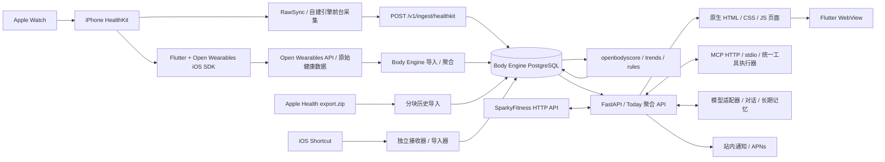

# ElderCare AI — Watch2Whoop 技术审计与迁移计划

审计日期：2026-10-26（Australia/Sydney）。本轮范围：Fork、Clone、Git 初始化、源码审计和规划；未实现 ElderCare 功能，未重构、部署或导入健康数据。

## 1. 仓库准备与审计基线

| 项目 | 已核验结果 |
|---|---|
| GitHub 当前账号 | `SydneyMCDonaldbigking`，`gh auth status` 与 `gh api user` 联网核验成功 |
| Git 提交身份 | `user.name = christianzhou77`；邮箱已在本机核验，为避免将个人联系方式写入公开仓库，此处不复制 |
| Fork | https://github.com/SydneyMCDonaldbigking/Watch2Whoop |
| Fork 关系 | GitHub API 确认 `fork = true`、父仓库为 `SongyuQi-Francisco/Watch2Whoop` |
| 本地目录 | `C:\Users\uryuu\Desktop\Watch2Whoop`；Clone 前确认为空目录 |
| 默认分支 | `main` |
| 当前开发分支 | `feat/elder-care-mvp`，从 `origin/main` 创建 |
| 审计提交 | `346cc78b4c5a6ad0162c931bb78deab810d61944` |
| 基线一致性 | 本轮只读 fetch 后，`HEAD`、`origin/main`、`upstream/main` 均为上述提交 |
| 本轮文件改动 | 仅新增本报告；未 commit、未 push，开发分支目前仅在本地 |

Remote 配置：

```text
origin    https://github.com/SydneyMCDonaldbigking/Watch2Whoop.git  (fetch / push)
upstream  https://github.com/SongyuQi-Francisco/Watch2Whoop.git   (fetch)
upstream  DISABLED                                              (push)
```

已设置 `remote.pushDefault = origin`，并取消开发分支对 `origin/main` 的 tracking，避免把功能分支误当默认分支推送。未修改原作者仓库、未强制推送、未覆盖原有文件。首次沙箱内登录检查受 DNS 限制失败；联网复核后确认授权有效，随后才执行 Fork。

后续同步工作流建议：先确保工作区改动已保存，再 `git fetch upstream`，在本地 `main` 上仅作 `git merge --ff-only upstream/main`；回到功能分支后合并或按团队约定整理上游变化。有分叉时先检查，禁止 reset 覆盖或强推。发布功能分支时明确指定 `origin feat/elder-care-mvp`。本轮没有执行这些后续发布动作。

## 2. 结论与改造方向

**适合在现有架构上渐进扩展，不能直接把当前产品包装成已经具备医疗监护能力的 ElderCare 系统。** 可复用采集、数据存储、评分、趋势、账号鉴权、MCP、模型适配、通知和功能开关；新增照护授权与用药领域，逐步增加适老界面。

关键决策：

1. 保留 FastAPI、PostgreSQL、Flutter + WebView、现有评分库与 MCP 工具执行链，不另建一套健康数据底座。
2. P0 保留 Open Wearables 主链路；自建 HealthKit 引擎客户端尚未完成全部后台能力，先随 upstream 迁移，不与适老 MVP 同时全面切换。
3. 家庭关系与健康数据授权分开建模。加入家庭、使用家属界面、具有管理员身份，都不能自动获得老人健康数据。
4. 用药提醒采用确定性日程、原生本地通知、服务端持久化任务及人工确认；不让 LLM 决定药量、改医嘱或推断“已经服药”。
5. P0 保留通用 AI 接入，但老人默认仅开放经过筛选的只读数据解释能力；语音健康对话和跌倒求助放到 P1。
6. 商业化前必须解决 SparkyFitness 的非商业许可。源码已有自有存储迁移的一部分，但尚不能视为完成替代。

### 审计口径

下文“已实现”表示在本次固定提交中找到相应路由、函数、迁移或客户端调用；不代表本机已端到端运行，更不代表经过临床验证。“建议”与“待实现”均为后续设计。

检查覆盖根 README、中文 README 对照、目录与依赖配置、全部 SQL 迁移的结构清单、API 注册与领域路由、MCP 注册和执行器、主要数据/权限路径，以及部署、评分、同意书和迁移设计文档。对复杂路径进行了定向源码阅读和交叉核验；本报告不等同于逐行安全认证或完整渗透测试。

## 3. 实际技术架构



### 3.1 目录与依赖

| 目录 | 代码中的职责与结论 |
|---|---|
| `body_engine/` | Python 3.12（`>=3.12,<3.13`），FastAPI/Uvicorn、psycopg 3 + pool；没有 SQLAlchemy ORM；SQL 直接通过参数化查询执行 |
| `packages/openbodyscore/` | 无第三方运行依赖的纯 Python 算法；Body Engine 以本地 path dependency 引入，旧导入路径有兼容别名 |
| `apps/watch2whoop/` | Flutter 3.47.7、Dart `^3.13.5`，版本 `1.0.8+8`；Flutter 依赖精确锁定，原生部分为 Swift/CocoaPods |
| `body_engine/src/body_engine/web/static/` | 核心业务 UI，原生 HTML/CSS/JavaScript，无 React/Vue 或打包步骤 |
| `health_sync/`、`shortcuts/` | 旧快捷指令上传和历史解析；接收器使用 Python 标准库，鉴权行为需特别加固 |
| `deploy/` | OW、SparkyFitness、Grafana、ASR、Tailscale 与运维脚本；并非一个根 Compose 就完整部署所有服务 |
| `quickstart/` | 合成数据演示和单独 Compose；不等同生产配置 |
| `assistant/` | AI 管家运行工作区；不等同于完整的自主医疗决策 Agent |
| `vendor/open-wearables` | Git submodule 固定到 `ff8527a52ad8a96cd1ebe8c19344295c934ae9dc`；本轮未初始化或下载子模块依赖 |

后端声明了 `mcp>=1.20`、Anthropic/OpenAI/Google SDK、cryptography、HTTPX、Pillow 等依赖，具体解析版本以 `body_engine/uv.lock` 为准。Flutter 使用 `open_wearables_health_sdk: 0.0.25`；`ios/Podfile.lock` 实际固定原生 `OpenWearablesHealthSDK 0.15.0`。Flutter 插件 pod 自身显示 0.0.24，不能误判成原生 SDK 也为该版本。

### 3.2 Apple Health / HealthKit 采集路径

**当前可保留的主要路径：** Apple Watch 数据进入 iPhone HealthKit，Flutter 的 `health_sync.dart` 包装 OW SDK；`AppDelegate.swift` 在 Flutter 尚未启动时初始化 SDK，恢复后台任务及观察器。SDK 上传到 Open Wearables，Body Engine 经 `importers/ow.py` 增量拉取日指标、睡眠和运动记录。`users.ow_user_id` 映射本系统用户与 OW 用户。

另有三条真实存在的路径：

- `RawSync.swift` / `raw_sync.dart`：补充逐拍 HRV、ECG、部分 SDK 不支持的类型，调用自己的 HealthKit ingest API。
- `history/`：用户分块、可续传上传 Apple Health `export.zip`，解析到 `export_samples` 等表；不依赖 OW 先接收完整历史。
- Shortcut → `health_sync/health_server.py` → `importers/shortcut.py`：上传原始样本后导入、重算最近日期。

**自建引擎进度必须分服务器与客户端：**

- 服务端已有 `rawdata/engine.py`、`derive.py`、`shadow.py`、`cutover.py`、`ow_archive.py`，以及迁移 690、800、830、840：接收来源/样本/统计桶、按 UUID 去重、删除传播、dirty-day 派生、影子比对、按用户切换/回退和历史存档均有代码。
- 实际模式是 `ow / shadow / app`，由功能开关与 `sync_mode_state` 共同决定；仅打开 `apple_sync_engine` 并不等于已经切换主数据源。
- `SyncEngine.swift` 与 `sync_engine.dart` 的实现和注释均表明客户端为 A1 前台核心：分页读取 quantity/category、上传成功后提交 anchor；A2 后台投递/BGTasks、A3 训练和统计桶尚待后续完成。服务端接受某字段，不代表手机已经会发送。
- 因此 P0 不删除 OW，不将其后台能力描述为已经由自建引擎全部替代。

数据来源选择也不是简单相加：`daily_metric_sources` 保存各源值，累计指标有完整度/设备去重规则；非累计数据、睡眠与原始样本各有选择规则，app 模式提高新引擎来源优先级。趋势必须携带来源、单位、同步时间和算法口径。

iOS 的锁屏、强制退出和系统后台调度会造成采集延迟。界面需区分“尚未同步”“没有佩戴/没有样本”和“确实活动减少”，不能把缺数据当成健康异常。可核验入口：`health_sync.dart`、`AppDelegate.swift`、`scores/inputs.py`、`rawdata/engine.py`、`docs/apple-sync-engine.md` 第 9 节。

### 3.3 Flutter 与页面结构

`main.dart` 加载账号、同步、语言和推送状态，进入 `OnboardingPage` 或 `HomePage`。`HomePage` 主要是全屏 WebView，嵌入 Body Engine Today 页面，处理登录码、深链接、同步、麦克风和语音桥接。

原生 Flutter 页面主要承担 onboarding、设置链接/扫码、权限、同步中心、范围选择和状态展示。业务导航实际在 `web/static/index.html`、`app.js`：今天、趋势、朋友、饮食、记录、我；朋友等能力受 flag 控制。适老化不能只修改 Flutter Theme，否则大部分业务文字与按钮不会变化。

源码已有 `offline_shell.dart` 和 `web/static/offline.js`，可缓存页面外壳及本人部分只读响应；README 中“WebView 没有离线缓存”的旧表述已不能完整代表当前代码。现有 read cache 排除他人数据、AI 和 ECG，并在退出/切换账号等场景清理。后续照护视图应继续禁止缓存他人健康明细。

### 3.4 FastAPI 与数据库

`api.py` 创建应用和 `psycopg_pool.ConnectionPool`（max_size=10），通过 lifespan 管理 MCP、插件调度和 OW watcher，注册账号、AI、records、scores/insights、sync/rawdata、friends、notify、history 等领域路由。静态页面由同一服务提供。

本轮 AST 清点发现 **382 个后端 Python 源文件、34 个含 HTTP 路由声明的模块、278 个路由装饰器**。此数字不含所有 ASGI mount 动态路由，也不证明每条路由都通过运行测试。

数据库共有 **101 个 SQL 迁移文件**。`db.py` 按完整文件名排序、逐个事务执行，并记入 `schema_migrations`；不是 Alembic，也不应重命名或重写已有迁移。

| 数据组 | 主要现有表 |
|---|---|
| 身份/授权 | `users`、`api_tokens`、`web_sessions`、`shares`、`user_consents`、`user_identities`、OAuth 表 |
| 原始/来源/同步 | `shortcut_samples`、`export_samples`、`hk_samples`、`hk_sources`、`hk_stats`、`rawdata_uploads`、`hk_dirty_days`、`sync_mode_state`、`ow_sample_cache` |
| 聚合/评分 | `daily_metrics`、`daily_metric_sources`、`sleep_sessions`、`daily_scores`、`workouts`、`healthspan_weekly`、`stress_daily` |
| 手工记录/规则 | `supplements`、`lab_results`、`events`、`journal_items`、`journal_entries`、`reminders`、`rule_runs`、`sleep_goals` |
| AI | `ai_providers`、`ai_conversations`、`ai_messages`、`ai_tool_calls`、`assistant_audit`、`ai_write_log`、长期记忆/状态表 |
| 共享/通知 | `circles`、`circle_members`、`circle_invites`、`notifications`、`push_devices`、`notification_settings` |
| 灰度/自有存储 | `feature_flags`、`user_cohorts`；`foods`、`food_entries`、`body_measurements`、`logged_workouts` 等 |

用户健康数据通常带 `user_id` 或 `owner_id/viewer_id`，主键/索引及部分复合外键体现隔离意图；公共字典、动作目录等全局表不能机械要求每行都有 `user_id`。**未在本仓库 SQL 中发现 PostgreSQL RLS policy**；主要防线是应用层按用户筛选，不应宣称已经有数据库强制租户隔离。

### 3.5 评分算法、来源与适用边界

真实计算在 `packages/openbodyscore/src/openbodyscore/`，编排和入库在 `body_engine/scores/engine.py`，原始输入读取在 `scores/inputs.py`。不是由 LLM 凭空生成分数。

- 恢复分：前 60 天个人基线，HRV 至少 14 晚；夜间 HRV 对数值、睡眠期低心率、睡眠表现、呼吸频率标准化后加权，权重 0.60/0.20/0.15/0.05，再映射到 0–100。缺 HRV 或基线不足时保留空值/原因。
- HRV 不是永远 SDNN：`scores/hrv_kind.py` 与迁移 715 默认允许足够逐拍数据的用户采用 RMSSD；覆盖条件为近 28 晚至少 21 晚且最近读数不超过 3 天。一个用户历史保持同一口径，完整重算才切换；选定 RMSSD 后缺数的夜晚不自动混入 SDNN。
- 睡眠分：移植 OW 0.9.0 规则，时长/阶段/规律/中断权重 40%/20%/20%/20%；睡眠需求/睡眠债有独立参数。
- 负荷：原始心率对应 Edwards TRIMP，再以 `21 × (1 − exp(−TRIMP/170))` 映射；CTL/ATL 使用 42/7 天模型。不能把低负荷直接解读为老人身体衰弱。
- 健康监测：`insights/coach.py` 使用 60 天个人区间，最低样本量、标准差带和最小带宽；`trends/series.py`、`trends/calc.py` 已有滚动曲线、HRV 相对基线及趋势计算。
- “身体年龄”“生病提示”和压力等均为解释性/启发式功能；部分常数为经验设计或单人校准，不能迁移成经验证的老人风险评分。

`METHODOLOGY.md` 与 `docs/scoring-validation.md` 区分文献依据、移植规格和设计参数。验证以合成数据、有限个体观察为主；HRV 对比有两名用户的方向性观察，不能称为充分多用户临床验证。没有证据证明在老年、房颤、起搏器、影响心率的药物使用者等群体中有效。

另一个需核验的兼容问题：`insights/coach.py` 和部分工具描述仍含固定 SDNN 标签，而计算口径可能已为 RMSSD。后续应按真实 `hrv_kind` 展示；本轮未修改算法或文案。

### 3.6 多用户、共享与撤销

- `auth.py` 仅存 Token SHA-256；普通 API、MCP-only 与 ingest-only Token 分开用途。`api.py` 从 Token/Session 取得 actor，通过 `resolve_owner` 和 `auth.can_view` 判断目标数据。
- `shares` 的手工 scope 有过期时间；圈子产生 `circle_scopes`，`granted_scopes` 合并两类授权。聚合 API/家属 briefing 还有逐块 scope 检查；不能仅检查最外层接口。
- `users.role` 的 `owner/member` 是部署管理含义，不能直接重命名为老人/家属。
- 手工家庭共享目前由管理员直接写 `shares` 表，`docs/admin-guide.md` 明确要求事先征求同意；尚无完整的老人自主授权面板与专用照护生命周期。
- 圈子已有邀请、选择共享范围、修改和退出，但它是多人共享模型。默认选项包括评分、睡眠、训练、饮食达标概要；并不适合作为默认关闭、特定家属可见的医疗隐私授权流程。ECG 被排除在圈子共享之外。
- `web/session.py` 实现 HttpOnly/Secure/SameSite=Strict cookie 和写请求自定义头；撤销 Token 后 Session 随之失效。Session 为最长 400 天并滑动续期，照护授权/设备丢失等敏感操作需评估二次验证与会话管理。
- 家属 briefing 当前不缓存，离线缓存也不保存他人明细，这是值得保留的设计。撤销仍无法收回对方已看到、截取或发往第三方模型的内容，需要明确告知与限制后续访问。

### 3.7 MCP 与 AI Agent

工具规格集中汇总于 `assistant/tools.py`，各领域 `*/tools.py` 提供定义；HTTP MCP、stdio 与站内对话共用 `datalayer/execute.py` 的 Executor、Policy、audit 和 write log。工具涵盖健康指标、评分、睡眠、训练、饮食、化验/补剂、提醒、记忆等；通过核心工具与按需发现避免每次发送全部定义。

远程 `/mcp` 使用 Streamable HTTP，按请求校验 MCP 专用 Token 或 OAuth access token；普通 API Token/页面 Cookie 不能直接混用。只读 Caller 不提供写工具，meta 工具解析到真实工具后仍作权限检查；写工具只允许本人，执行和失败都会留审计。MCP 客户端的交互确认由客户端承担，不能把 prompt 中“请确认”当服务端强制限制。

站内 AI 有 Anthropic、OpenAI Responses、OpenAI-compatible、Gemini 适配器，可连接兼容接口的自托管模型；会话、工具调用和记忆存于 PostgreSQL。API key 由 AES-256-GCM 加密，AAD 绑定用户，主密钥来自 secret 文件；这不等于全部健康数据库已加密。

已有管理员提供的 DeepSeek fallback，需用户单独确认；自己的 API key 与 fallback 的作用域不同。`ai/chat.py`、`ai/params.py` 对特定删除/撤销工具有确认流程，但不是所有写工具都会确认。`ai/scope_guard.py` 主要控制 fallback 的话题范围，**不是防止诊断、医嘱修改或紧急分诊的医疗安全模块**。

语音已有两种代码路径：iOS `VoiceInput.swift` 强制设备端 Speech 识别，中文可把暂存在内存的 PCM 发至自托管识别器校正；`ai/asr.py` / `deploy/asr/` 提供 sherpa-onnx + SenseVoice 的 CPU 服务。未发现完整的适老 TTS、持续语音对话和用药语音确认闭环；不需为了复用语音先安装 CUDA。

### 3.8 通知与部署

`notify/core.py`、`store.py`、`apns.py` 和 Flutter push bridge 已实现站内通知、设备注册、APNs、未读数及静默时间。当前类别主要是圈子、系统和 AI 额度卡；同类通知可在 30 分钟内合并，默认 23:00–07:00 静默。后台发送队列在进程内，尚无适合用药工作流的持久化 transactional outbox/重试/逐次到期追踪。不能将通知已发出、APNs 已受理、用户已看到和已服药混成同一状态。

根 `compose.yaml` 仅定义 Body Engine + PostgreSQL 17.11，API 8100、数据库 5433 绑定回环地址。Dockerfile 使用 Python 3.12.15、uv 和本地评分包命名 build context，需要支持 additional_contexts 的 Compose。OW、SparkyFitness、Grafana 各有 Compose；OW 包含数据库/任务队列/对象存储等附加服务。默认通过 Tailscale HTTPS 访问。

OW 部署还有 `patches/refresh_token_service.py` 的挂载补丁：允许特定未被使用的 successor Token 重放，默认宽限 720 小时。它解决同步中断，但也改变上游刷新策略，升级时必须复核安全权衡，不能把 OW 描述为完全没有运行补丁。

`deploy/ops/` 有按用户批处理、健康检查、restic 加密备份和恢复演练，保留 7 日/4 周/6 月快照。定时安装脚本基于 macOS LaunchAgents；Linux 生产运维迁移尚需单独完成。Quick Start 没有等同生产的定时任务/备份配置，Windows 未被上游列为已验证部署平台。本轮没有运行安装器、Docker、WSL 或下载模型。

## 4. 可直接复用与必须补齐的能力

| 能力 | 复用程度 | ElderCare 所需工作 |
|---|---|---|
| Apple Watch/HealthKit 与历史导入 | 复用主链路 | 明确新鲜度与缺失状态，不在 MVP 切断 OW |
| PostgreSQL 日指标、睡眠、评分 | 直接复用数据结构 | 新照护表引用同一用户，不复制全部健康数据 |
| 纯函数评分、参数和 golden fixtures | 复用 | 保留算法版本和缺数原因，新增适老解释与验证 |
| 趋势/个人基线/健康区间 | 部分复用 | 增加睡眠/活动的持续偏离策略、数据质量与通知抑制 |
| Token/Session、scope 检查 | 复用 | 新增照护授权并扩展所有入口的拒绝用例 |
| 圈子邀请、同意书版本记录 | 复用组件与模式 | 独立照护关系，避免群共享或管理员写表充当老人同意 |
| 通用规则 reminders、站内/APNs | 复用展示/渠道 | 新增用药日程、持久化调度、确认/未确认与家属通知 |
| supplements | 仅可借鉴表单 | 不能直接充当处方药、药量变更、服药事件模型 |
| 模型 adapters、MCP、审计和记忆 | 复用 | ElderCare 默认只读工具白名单、出境授权、事实来源展示 |
| 原生语音/CPU ASR | 部分复用 | P0 辅助朗读/操作；P1 再做完整语音健康助手 |
| Flutter/WebView、双语和离线基础 | 复用 | 适老页面、语义可访问性和原生通知/朗读桥接 |
| Feature flags 与用户 cohort | 直接复用机制 | 所有新功能默认关闭，并在后端同步检查 |
| 部署、备份和监控 | 复用配置模式 | 验证目标主机、常驻调度、恢复流程和敏感日志策略 |

## 5. P0 目标架构与模块划分（建议，未实现）

优先在 `body_engine/src/body_engine/eldercare/` 新建独立领域包，包含 `api.py`、`permissions.py`、`family.py`、`medications/`、`trends/`、`tools.py`、`params.py`，通过少量明确入口注册。前端新增 `web/static/eldercare/` 与有限原生桥接。原评分和导入模块通过服务函数复用。

现有 `plugins.py` 支持 `BODY_PLUGIN_DIR` 的 router、jobs、静态资源和命名空间迁移，适合将来部署可选扩展；但**没有自动接入现有全部 AI 工具与导航的万能钩子**，仍需小范围明确集成。建议 MVP 采用仓库内模块 + feature flags，避免依赖私有机器路径或另建完整框架。

拟议 flags：`eldercare_ui`、`eldercare_family`、`eldercare_trends`、`eldercare_medications`；这些 key 目前不存在，开发时再登记 registry。关闭功能需同时关闭 API、工具和页面入口。开关现有缓存最长约 30 秒，不应用于要求即时生效的照护授权撤销；授权必须实时查库。

### 5.1 老人端与家属端

老人界面聚焦“今天、用药、家人/帮助”三处入口；首页显示同步状态、少量趋势、下一次提醒和确认按钮。隐藏默认训练竞赛、身体年龄排名与复杂营养设置，保留可退出的专业视图。家属界面按老人切换，展示允许的概要和待确认事项，不展示无授权的原始数据。

设计目标：正文约 20–24sp、主要按钮 48–56pt、系统字体缩放至 200% 仍可完成核心任务；采用文字+图标+状态说明，避免单靠红绿颜色；完整 VoiceOver 标签、焦点顺序、减少动画、足够对比和清晰撤销反馈。具体尺寸是产品目标，须在真机与老人测试中调整。

P0 语音辅助优先使用系统读屏与按需朗读，后续可通过 `AVSpeechSynthesizer` 等原生能力补充。现有输入按钮可复用，但用药名称、剂量和执行操作必须回显，确认前不执行。家属可协助设置，确认授权仍由老人本人操作；合法代理/能力受限的特殊流程留待明确法律依据后单独设计。

### 5.2 家庭绑定与明确授权

1. 家属创建一次性、有期限的绑定邀请；老人独立登录后核验对方身份并接受关系。
2. 接受关系不产生健康数据权限。老人另行逐项勾选趋势、用药概要、提醒接收、AI 数据转发等范围，初始全部不勾选。
3. 授权记录老人 actor、家属、scope、有效期、同意书版本和确认方式；家属不能代老人签发。
4. 老人可随时缩减或撤销，下一次 API/MCP 调用和队列发送立即重新判权。撤销后停止新通知并清理可清理的服务端摘要/待发任务。
5. 圈子和旧 `shares` 权限可能仍存在，撤销界面必须显示剩余共享来源。不能宣称撤销一条照护授权就撤销全部历史圈子授权。

建议 `care_grants` 成为照护授权的唯一记录源。新照护 API 和工具统一经过 `require_care_access(actor, subject, scope)`，不直接信任圈子共享或客户端提供的 owner ID，也不覆盖 `shares.scopes` 的手工授权。需要整合旧授权时，应明确维护来源并测试撤销，避免并行权限源发生“撤销后从另一条路径重新放行”。

### 5.3 健康趋势

复用日指标、睡眠、HRV/静息心率基线和趋势曲线，新增统一输出：当前窗口、个人基线窗口、有效天数、数据来源、最后同步时间、缺失原因、偏离方向/持续天数、算法版本和解释证据。

建议初期使用独立、可配置的确定性规则：近期 7 天与之前 28/60 天比较，样本量不足只显示“正在建立基线”；将睡眠时长/规律、静息心率、步数/活动分钟分开。均值/标准差可先复用，必要时在新模块评估中位数/MAD，不能悄悄改变原恢复分。比较窗口避免重叠造成基线污染，且保持 HRV 类型、心率口径和设备来源可比较。

通知触发需连续有效数据、同步新鲜度、冷却时间和人工可理解证据；缺数/停戴应归为“数据暂缺”，不产生医学异常判断。默认文案“与您平时有变化，可留意并按需要咨询专业人员”，不输出疾病概率或自动诊断。具体阈值需单独验证，不能把本报告中的候选窗口视为临床阈值。

### 5.4 用药提醒闭环

药单来源为用户依据医嘱录入或核对的记录。药名、剂量、途径、频次、开始/结束时间、时区和提醒规则版本化；家属 P0 仅可建议/提交待核对草稿，不能直接修改已确认药单。AI 不提供更改医嘱、停药、补服或加量工具。

每次计划服药生成唯一 occurrence：`scheduled -> confirmed_taken / explicit_skipped / overdue_unconfirmed`。用户可报告漏服并留更正历史；“没有点确认”只表示未确认，不是已证实漏服。记录 actor、实际服药时间与录入时间，不把通知点击自动当服药事实。

采用原生本地通知承担已下载日程的离线提醒；服务端持久化 occurrence + outbox 负责补偿与家属提醒。按次去重、重试、记录调度延迟；不复用社交通知的全类别 collapse 与静默合并。药单修改、停用、退出和换机需取消/更新待发本地提醒。不能承诺关机、通知权限关闭或专注模式下仍必达。

时区以老人的 IANA zone 为准，存本地计划与计算后的 UTC；覆盖 Sydney 夏令时跳时/重复时刻、跨午夜、旅行、换时区和迟到离线确认。每个日程版本+本地日期+时段仅产生一次有效计划，DST 处理策略由用户核对，不因重试多生成一次服药机会。

家属提醒使用“截至某时尚未收到确认”，需要老人对收件人与事件类别单独授权；发送时重新检查授权有效性。锁屏/APNs payload 默认仅含通用提醒与不透明事件 ID，不含药名、剂量或详细健康数值，打开应用后再鉴权读取。

## 6. 数据库与 API 改造建议

### 6.1 建议新增的领域表

以下是逻辑草案，不是已经执行的 DDL。核心迁移采用新增文件、序号在开发时避开 upstream 最新迁移；插件形式可用 `eldercare/<migration>` 命名空间。所有新表使用稳定前缀，避免同名污染。

| 建议表 | 最少字段/约束 |
|---|---|
| `ec_user_preferences` | `user_id`、适老模式、常用界面、字体/语音偏好；界面角色不直接授予数据权限 |
| `ec_families` / `ec_family_members` | family、成员 `user_id`、关系和状态；成员不自动获授权 |
| `ec_care_invitations` | 邀请摘要、发起人、目标、过期/使用/撤销时间；明文不入日志 |
| `ec_care_grants` | `subject_user_id`、`caregiver_user_id`、scope、版本、`granted_at/expires_at/revoked_at`、确认 actor；scope 不默认通配 |
| `ec_consent_events` | 授予/缩减/撤回事件、同意书版本、参与方与时间；与健康处理总同意分开 |
| `ec_medications` / `ec_medication_schedules` | `user_id`、药单与日程版本、人工核对状态、local time、IANA zone、有效期 |
| `ec_dose_occurrences` | `user_id`、schedule/version、local date/slot、due UTC、状态；唯一键防重复计划 |
| `ec_dose_events` | occurrence、`user_id`、actor、事件类型、实际时间/录入时间、`idempotency_key`；保留修正链 |
| `ec_trend_events` | `user_id`、指标/窗口、质量状态、偏离证据、规则版本、冷却/处理状态 |
| `ec_notification_outbox` | subject、收件人、事件、授权引用、due/retry 时间、attempt/state；事件+收件人+渠道唯一 |
| `ec_access_audit` | actor、subject、资源类别、动作、授权 ID、结果、时间；默认不复制完整健康正文 |

保留现有 `users`、`daily_metrics`、`daily_scores`、`sleep_sessions`、通知设备和会话表；不再创建第二套老人健康主表。新明细外键采用 `(user_id, resource_id)` 复合约束，阻止跨用户挂接；任何 UUID/数值 ID 查询仍必须带 subject 条件。

隔离建议：先为新模块建立统一权限检查和拒绝测试，再评估新表启用 RLS。RLS 需配套非 owner/非 superuser 的应用连接角色、事务内 `SET LOCAL` 与 pool 清理测试；仅增加 policy、继续使用可绕过策略的账号并不能形成防线。全仓库 RLS 改造另开阶段，避免 MVP 大规模重构。

健康行、药单、审计参数、对话与备份都纳入保留期/访问/加密设计；现有 AI key 加密不能替代磁盘、数据库、备份和密钥分离策略。

### 6.2 建议 API 契约

建议统一前缀 `/v1/eldercare`，复用现有 current_user/CSRF/写 scope 规则；以下路由均为提案。

| 操作 | 建议接口 | 权限边界 |
|---|---|---|
| 个人设置 | `GET/PATCH /me/preferences` | 本人；写操作需 write |
| 家庭与邀请 | `POST /families`、`POST /invitations`、`POST /invitations/{id}/accept` | 接受邀请者须独立登录；不产生健康 scope |
| 授予/撤回 | `POST /me/care-grants`、`DELETE /me/care-grants/{id}` | 仅数据主体本人；家属不能自我授权 |
| 被授权老人列表 | `GET /me/care-subjects` | 只返回关系与有效授权，不泄露其他家庭成员 |
| 健康概要/趋势 | `GET /subjects/{id}/summary`、`GET /subjects/{id}/trends` | 本人或相应有效照护 scope；逐块过滤 |
| 药单 | `GET/POST /me/medications`、`PATCH /me/medications/{id}` | 本人确定性操作及版本检查；AI 无直接写入口 |
| 日程/确认 | `GET /me/doses`、`POST /me/doses/{id}/events` | 本人写入，幂等键、版本/冲突检查 |
| 家属用药概要 | `GET /subjects/{id}/medication-summary` | 单独用药 scope；不默认开放处方详细备注 |
| 通知订阅/审计 | `GET/PUT /me/care-notification-settings`、`GET /me/care-access-log` | 不得扩大老人 grant；日志严格按可见主体过滤 |

服务层从已鉴权 actor 解析 subject，不信任请求体里的 `user_id`。未授权、已撤销、过期、被删除等场景返回一致的拒绝结果，尽量不暴露对象存在性。列表、导出、聚合、图表、通知深链接和 MCP 必须复用同一授权函数；UI 隐藏不能替代 API 检查。

P0 MCP 只增加只读 `get_care_summary`、`get_care_trends`、`get_medication_schedule` 等经筛选工具。家属数据传给外部 AI 还需独立的 egress 授权；scope 和出境许可不足时不得把授权数据塞入 briefing、模型历史或自动摘要。原有 MCP 写能力仍可保留给原产品普通账号，ElderCare 模式需按所有通道强制工具白名单，不能只改 prompt。

## 7. P1 扩展评估

| 模块 | 现状与建议 |
|---|---|
| 跌倒事件/求助 | 当前无 `CMFallDetectionManager`、跌倒 entitlement 或求助状态机。先做 Apple 能力验证；HealthKit 的跌倒次数是可能延迟的历史记录，不能当实时报警信号 |
| AI 语音健康助手 | 复用原生输入/CPU ASR、adapters 与只读工具；补 TTS、明确停止/取消、误识别回显、隐私确认和安全评测，不训练/部署新模型作为 P0 前提 |
| 行动能力/生活规律 | 先评估现有 HealthKit 类型和目标设备实际供数，再考虑步态、步行速度、活动/睡眠节律；无数据不推断失能，不依据模型自行做 ADL 医疗结论 |
| 家属远程关怀 | 扩展授权事件订阅、非紧急关怀确认与人工联系流程；每条通知有证据、新鲜度、收件人授权、冷却和状态追踪 |

Apple 官方区分延迟的 HealthKit 样本与实时 Core Motion fall detection；实时接口需要 Apple 特殊 entitlement、用途说明、系统支持与用户授权，可能涉及 watchOS 原生 target，不能只增加 Flutter 页面就承诺可用。[Apple CMFallDetectionManager](https://developer.apple.com/documentation/coremotion/cmfalldetectionmanager)、[Fall Detection entitlement](https://developer.apple.com/documentation/bundleresources/entitlements/com.apple.developer.health.fall-detection)。

求助流程应由确定性事件和明确用户操作驱动：收到设备事件/本人求助 → 展示确认或联系入口 → 按事先授权通知家属 → 记录处理。AI 可以解释已发生的数据与流程，不判断是否发生紧急医疗事件，也不自动替代 Apple 原有紧急响应。

## 8. 隐私、AI 与医疗边界

### 澳大利亚优先

上线前按产品实际业务确认 Privacy Act/APPs 适用范围；健康服务提供者可能不受一般小企业豁免保护，不能因团队小或自托管就假定不适用。[OAIC small business](https://www.oaic.gov.au/privacy/privacy-guidance-for-organisations-and-government-agencies/organisations/small-business)。

技术落地建议：数据最小化、用途与版本化同意、老人可查可改可撤回、家庭与运营人员最小权限、敏感日志控制、删除与备份恢复后重新执行删除清单。建立数据清单和泄露响应机制；符合条件的数据泄露需按 NDB 处理。[OAIC privacy management](https://www.oaic.gov.au/privacy/privacy-guidance-for-organisations-and-government-agencies/health-service-providers/guide-to-health-privacy/chapter-1-key-steps-to-embedding-privacy-in-your-health-practice)、[OAIC breach response](https://www.oaic.gov.au/privacy/notifiable-data-breaches/quick-reference-guide-for-responding-to-data-breaches)。

澳大利亚数据区可作为首发默认部署选择，但本地存储不自动解决远程运维、跨国家属和模型 API 的境外披露。逐个梳理模型、APNs、遥测和运营访问，分别说明接收方、用途、地点、保留/训练政策与退出方式；APP 8 的跨境要求需按具体情形评估，同时核对 NSW、Victoria、ACT 等可能适用的健康隐私规定。[OAIC health information disclosure](https://www.oaic.gov.au/privacy/privacy-guidance-for-organisations-and-government-agencies/health-service-providers/guide-to-health-privacy/chapter-3-using-or-disclosing-health-information)。

TGA 是否监管取决于预期用途、宣传和实际全部功能。仅写“非医疗建议”不能自动排除监管；若后续做疾病预测、药物决策或紧急事件判断，需重新评估。[TGA software exclusions](https://www.tga.gov.au/products/medical-devices/software-and-artificial-intelligence-ai/overview/software-based-medical-device-exclusions)。

### 其他市场与 Apple 约束

欧盟健康数据属于 GDPR 特殊类别，若进入适用范围，需单独核验处理基础、特殊类别条件与跨境/主体权利流程；不复用一份澳大利亚同意书覆盖全球。[European Commission sensitive data](https://commission.europa.eu/law/law-topic/data-protection/information-individuals_en)。其他市场先建立“地区—数据流—适用规则”评估，再决定上线；`docs/multi-region.md` 标为方案，不能视为当前已上线的区域隔离能力。

HealthKit 数据、用途说明、第三方 AI 披露与分发需按 Apple 当期审核条款核验；自托管不免除要求。[Apple App Review Guidelines](https://developer.apple.com/app-store/review/guidelines/)。

### AI 与提醒的硬边界

- 只解释可追溯数据与生活辅助信息，始终显示数据时间与缺数；不诊断、不更改医嘱、不建议补服/加量，不自行判定紧急医疗事件。
- 通过 tool allowlist 和服务端校验约束行为，药物执行指令不交给模型；OCR/语音只生成待核对草稿，不能因模型自称“已确认”越权。
- 家属授权、外部模型披露、数据研究/算法验证分别记录同意；不将既有服务同意自动扩成研究许可。
- 不配置模型时，健康展示、家庭授权与用药提醒仍可运行；规则与通知不依赖模型可用性。
- Apple 说明本地和远程通知都不保证送达。计划本地通知可改善离线提醒，但不能承诺替代专业监护或可靠紧急通信。[Apple User Notifications](https://developer.apple.com/documentation/usernotifications)、[Apple local scheduling](https://developer.apple.com/documentation/usernotifications/scheduling-a-notification-locally-from-your-app)。

## 9. License 与商业使用风险

| 部分 | 实际许可/依据 | 对 ElderCare 的影响 |
|---|---|---|
| 服务端、部署、文档等 | 根 `LICENSE`：AGPL-3.0 | 允许商业使用；修改版通过网络提供交互服务时，须按第 13 节向相关用户显著提供对应源码。不能把修改后的服务器整体改标 MIT/闭源 |
| Flutter app、Shortcut | 各自目录 MIT LICENSE | 可商用修改分发，保留版权/许可；独立 MIT app 不会使 AGPL 服务器改为 MIT |
| 评分包 | Apache-2.0 + `NOTICE` | 可复用，保留许可/通知及来源，满足修改标注等要求 |
| Open Wearables | MIT；固定 submodule + SDK 来源记录 | 保留许可及移植代码归属；运行补丁也纳入版本维护 |
| SparkyFitness v1.8.0 | 作者自定义非商业许可 | **商业化阻断项**：间接用于有商业利益的服务也受限制；作为独立未修改容器或只走 HTTP API 不能自动豁免 |
| Grafana OSS | AGPL-3.0，可选独立服务 | 保持许可边界；自定义修改需分别审查义务 |
| 动作文本/图片/图标 | `THIRD_PARTY_NOTICES.md` 逐来源列明 | 部分文本为 MIT/AGPL，图标有 MIT/ISC，授权图片有 CC-BY-SA；不能一概按公共领域处理 |

已读取 SparkyFitness 固定版本的[官方 LICENSE](https://raw.githubusercontent.com/CodeWithCJ/SparkyFitness/v1.8.0/LICENSE)。在商业服务中复用前，应取得作者书面商业授权，或使用独立实现并验证已脱离该服务的路径；本轮没有联系作者或申请授权。其源码不应复制进本仓库以“替换”接口层。

源码显示 `735_own_food_store.sql`、`ownstore/mirror.py` 与 `sparky-migrate` 已实现建表/双写和迁移核对；`own_food_read`、`own_food_only` 在设计文档中出现，但当前 Python 代码尚无对应实现。因此不能声称现在关闭容器就能完成商业可用替代。可先做不依赖其饮食/训练功能的照护垂直切片，之后单独验证 provisioning、today 聚合、训练、营养、体重、删除和备份等路径不再依赖它。

`docs/LICENSES.md` 对 free-exercise-db 图片仍有较宽泛的 Unlicense 描述，而更新的 `THIRD_PARTY_NOTICES.md` 明确图片原始出处不明、商业前需关闭该批媒体。以实际素材和上游原始许可逐项核验；采用 `exercise_media_free_db_off` 等控制并不能代替全量素材清单。保留 wger/Everkinetic 等 CC-BY-SA 署名、链接及修改说明。

“ElderCare AI” 还需独立做商标/品牌检索；不使用 WHOOP/Apple 标志或暗示认可。商业发布前进行 SBOM、容器/依赖许可与漏洞扫描，当前报告不是法律批准。

## 10. 现有技术风险与优先级

| 优先级 | 已发现风险/证据 | 建议处置与验收 |
|---|---|---|
| P0 | `health_sync/health_server.py` 默认 `REQUIRE_TOKEN` 为 false；无 Token 上传映射固定 owner；监听含 `0.0.0.0` | 真实用户接入前关闭旧入口，或强制 Token、限制网络、核对部署配置；无凭据请求必须拒绝。当前仓库默认有风险，不代表已证实某线上部署暴露 |
| P0 | 应用层隔离为主，无 RLS；管理员手工 grants，尚无专用照护撤销闭环 | 全入口授权矩阵、复合外键、最小 DB 角色；先完成家庭授权再展示家属数据 |
| P0 | SparkyFitness 非商业许可，自有替代仅部分实现 | 商业试点前取得授权或完整移除依赖；不能用“独立服务”作为免责 |
| P0 | 当前推送队列在内存，社交合并/静默不满足用药工作流 | occurrence + 持久化 outbox、本地通知和未确认语义；重启、离线、时区、撤销后不发送均验收 |
| P0 | 评分缺乏针对老年群体的验证，存在未验证启发式健康提示 | 分数作为辅助信息；默认不突出疾病/身体年龄结论，验证适用性后再扩展 |
| P1 | 自建同步引擎前台已实现，后台与 A3 未齐；相关服务器切换代码已在 | 保留 OW，避免双重迁移；切换需验证样本完整度与后台供数 |
| P1 | Token/session 有长期有效设计，MCP 写 scope 较粗，现有确认只覆盖部分工具 | 设备撤销、敏感操作二次核验、照护模式工具白名单和实时授权；全通道测试 |
| P1 | 健康数据库/审计/对话不等于已加密，管理员可访问，删除可能有 external leftovers | 数据区/磁盘与备份加密、访问审计、异步删除补偿；恢复后重放删除，明确备份轮换 |
| P1 | OW refresh 补丁改变旧 Token 重放窗口 | 独立安全复核、升级回归；不要在本轮无证据改动运行参数 |
| P1 | 大量聚合接口与外部服务共用连接池；并发聊天/查询可能占用连接 | 以压测确定分页/查询窗口、超时、任务外置与 pool 容量；不默认重写框架 |
| P1 | 运维安装依赖 macOS，根 Compose 缺外部服务/secret；Windows 无已验证运行结论 | 明确开发/生产宿主，后续单独交付容器 worker 或目标平台调度；本轮不安装环境 |
| P1 | 文档随迁移存在滞后：HRV 标签、离线能力、图片许可、存储读路径 | 每个里程碑用固定提交对照代码/文档，不能只照 README 验收 |

## 11. 分阶段 MVP 开发计划

工作量为规划估算，按一名熟悉项目的全栈工程师、可用的 iOS 工程支持和产品/隐私评审资源计算；可重叠但不承诺日历交付。硬件、Apple 权限审批、商业授权和真实用户招募另计。

| 阶段 | 内容/依赖 | 预计 | 完成门槛 |
|---|---|---|---|
| 0 本轮 | 仓库初始化、审计、计划 | 已完成 | 仅文档变更；下一轮开发须收到指令 |
| 1 基础与隐私 | 模块边界/flags、接口契约、适老原型、身份与授权模型；关闭旧无 Token 入口；商业许可路径决定 | 1–2 周 | 双语原型可审查、全部 scopes/状态有定义；仅合成数据验证；确定可运行基线 |
| 2 家庭与适老切片 | 老人/家属视图、邀请、主动授予与撤销、审计、字体/读屏；不自动继承圈子授权 | 约 2 周 | 两名独立用户可绑定；未授权/过期/撤销实时拒绝；老人能独立完成关键任务 |
| 3 个人趋势 | 复用睡眠/心率/活动；基线、新鲜度、缺失/持续偏离、只读 AI 解释 | 1–2 周 | 合成场景证据一致；停戴/断网不误报；无医学诊断文本与隐式第三方披露 |
| 4 用药闭环 | 人工核对药单/日程、原生本地提醒、occurrence/events、持久化 worker/outbox、未确认家属通知 | 2–3 周 | DST、离线、重启、重复请求、更正、换机/撤销测试通过；AI 无药量修改能力 |
| 5 小规模试点 | 明确同意的老人和家属试用；运营/恢复/删除、许可清单、安全与可访问性核验 | 1–2 周 | 授权与提醒指标有记录、无阻断风险；可一键关闭模块；评审后才扩大 |

估计约 8–11 个工程周；P0 不包含实时跌倒集成、持续语音助手、临床监测或全球化部署。任何需要新增本机开发环境的步骤另行明确，不自动安装 WSL/CUDA。

### MVP 验收矩阵

1. **授权**：老人 A、家属 B、无关用户 C；覆盖未绑定、绑定未授权、单 scope、到期、撤销、被禁用/删除；API、MCP/meta、聚合、导出、通知队列/深链接均不越权。直接替换 ID 不能读取另一用户资源。
2. **适老**：大字体/200% 缩放、VoiceOver、触控、减少动画、低网速、同步中断下可完成绑定、查看和服药确认；两种语言都可用。
3. **趋势**：基线不足、缺失、多来源、设备变化、SDNN/RMSSD、补传重算均返回正确证据和状态；AI 无数据时明确说不知道。
4. **用药**：同一个请求重试不重复确认；一次提醒不生成多次服药机会；晚同步可更正未确认事件；不把无响应归为医学事件或强迫补服。
5. **时间/交付**：Sydney DST、跨午夜、旅行时区、通知关闭、手机离线、服务重启/多 worker、推送失败与授权中途撤销；每次处理可追踪，锁屏不泄露药单。
6. **恢复与退出**：账号删除和断开家属关系后队列/访问停止；外部删除失败有补偿记录；备份恢复不复活已撤销授权或已删除账号。
7. **许可与模块关闭**：商业路径不再依赖未经授权的 SparkyFitness/未知图片；所有 ElderCare flags 关闭后保留原 Watch2Whoop 核心行为。

## 12. 本轮验证与未验证项

已完成：

- 联网核验 GitHub CLI 身份、Fork 父子关系、默认分支和三个 ref 的提交一致性；核验 Remote 与禁用 upstream 推送配置。
- 对 382 个 Body Engine Python 源文件执行 `ast.parse`，无语法错误；清点 101 个 SQL 迁移与 API 声明。这是静态检查，没有执行迁移或启动 API。
- 使用 Codex 已捆绑的 Python 3.12.14、不开新环境，直接调用现有 `packages/openbodyscore/tests/test_golden.py` 的 `test_matches_golden` 与 `test_v12_matches_golden`，两项断言通过。不是完整 pytest 套件运行，也不能证明医学有效性。
- golden 初次在 Windows 默认文本编码下出现中文错误消息对比失败；为该检查进程开启 `PYTHONUTF8=1` 后通过。未为此修改产品代码，后续 Windows 验证应显式使用 UTF-8。
- 本报告交付前检查本地引用、Markdown 基本结构、隐私扫描与 Git diff，确认仅此文档是新增工作区变更。

未验证：没有 pytest/Flutter/Docker/uv 在当前 PATH 下的可用完整工具链；没有安装它们。未执行完整后端/Flutter/数据库集成测试、SQL 实际迁移、服务构建、真机 HealthKit/推送/语音、性能测试或商业合规认证。子模块未初始化；上游 README 和历史测试结果不作为本轮实测成功。

仓库 CI（`.github/workflows/ci.yml`）配置了 Postgres 17 服务、Body Engine/评分库 pytest、Python/JS/shell 语法、隐私扫描、Flutter 测试和相关构建。后续实际开发应按变更运行这些适用检查；本轮没有创建 PR 或声称 CI 已运行通过。

## 13. 主要代码与文档证据索引

路径相对仓库根目录；事实以本报告记录的提交为准。

| 主题 | 主要证据 |
|---|---|
| 项目/贡献/目录许可 | `README.md`、`README.zh-CN.md`、`CLAUDE.md`、`CONTRIBUTING.md`、`LICENSE`、`docs/LICENSES.md`、`THIRD_PARTY_NOTICES.md` |
| 依赖与 CI | `body_engine/pyproject.toml`、`body_engine/uv.lock`、`apps/watch2whoop/pubspec.yaml`、`pubspec.lock`（app 内）、`ios/Podfile.lock`（app 内）、`.github/workflows/ci.yml` |
| API 入口与 DB | `body_engine/src/body_engine/api.py`、`config.py`、`db.py`、`migrations/` |
| HealthKit / 主同步 | `apps/watch2whoop/lib/src/health_sync.dart`、`ios/Runner/AppDelegate.swift`（app 内）、`body_engine/src/body_engine/importers/ow.py` |
| 自建引擎 / 补充采集 | app 内 `lib/src/sync_engine.dart`、`raw_sync.dart`、`ios/Runner/SyncEngine.swift`、`RawSync.swift`；后端 `rawdata/engine.py`、`ingest.py`、`derive.py`、`cutover.py`、`ow_archive.py` |
| 同步设计与历史 | `docs/apple-sync-engine.md`、`docs/apple-sync-engine-app-contract.md`、`docs/shortcut-sync-spec.md`、后端 `history/`、`health_sync/health_server.py` |
| Flutter/Web 页面 | app 内 `lib/main.dart`、`lib/src/pages/home_page.dart`、`offline_shell.dart`；后端 `web/api.py`、`web/static/index.html`、`app.js`、`offline.js` |
| 评分/验证 | `packages/openbodyscore/METHODOLOGY.md`、`src/openbodyscore/params.py`、`recovery.py`、`sleep.py`、`strain.py`（包内）；后端 `scores/inputs.py`、`engine.py`、`hrv_kind.py`；`docs/scoring-validation.md` |
| 趋势/规则 | 后端 `insights/coach.py`、`insights/views.py`、`trends/series.py`、`trends/calc.py`、`rules/engine.py` |
| 鉴权/共享 | 后端 `auth.py`、`records/api.py`、`web/session.py`、`friends/api.py`、`friends/params.py`、`friends/store.py`；`docs/admin-guide.md` |
| 同意与删除 | 后端 `profile/`、`account/delete.py`、迁移 140；`docs/family-consent.md` 及英文版本 |
| MCP / Agent | 后端 `mcp_server.py`、`assistant/tools.py`、`assistant/toolsets.py`、`datalayer/execute.py`、`ai/mcp_http.py`、`ai/tokens.py`、`ai/oauth*.py`、`ai/chat.py`、`ai/params.py` |
| AI key / 语音 | 后端 `ai/crypto.py`、`ai/providers.py`、`ai/adapters/`、`ai/asr.py`；app 内 `ios/Runner/VoiceInput.swift`；`deploy/asr/` |
| 推送 | 后端 `notify/api.py`、`notify/core.py`、`notify/params.py`、`notify/apns.py`；app 内 `lib/src/push.dart` |
| 扩展与开关 | 后端 `plugins.py`、`rollout/`；`docs/rollout.md`、`docs/datalayer-design.md` |
| Sparky 替代进度 | 后端 `ownstore/mirror.py`、`ownstore/migrate.py`、迁移 735；`docs/own-food-weight-storage.md` |
| 部署/运维 | `compose.yaml`、`body_engine/Dockerfile`、`quickstart/README.md`、`deploy/open-wearables/README.md`、`deploy/sparkyfitness/README.md`、`deploy/grafana/README.md`、`deploy/ops/README.md`、`deploy/ops/ops.py` |

## English handoff summary

The fork and local `feat/elder-care-mvp` branch are ready at the audited commit. Only this planning document was added; no product implementation, commit, push, or deployment was performed. Reuse the existing FastAPI/PostgreSQL data layer, Flutter WebView shell, scoring package, authentication, MCP executor, model adapters, and notification channels. Keep Open Wearables for the MVP: the replacement client currently implements the foreground core, not the complete background pipeline.

Add explicit elder-controlled care grants, accessible views, data-quality-aware personal trends, and a deterministic medication schedule/confirmation workflow with persistent delivery. Never treat missing confirmation as proven non-adherence. Disable or authenticate the legacy unauthenticated Shortcut receiver before onboarding real users. Resolve SparkyFitness's non-commercial license and third-party media rights before commercial use. AI remains an optional assistant for authorized data explanation; it cannot change prescriptions, diagnose disease, or decide that a medical emergency has occurred.
