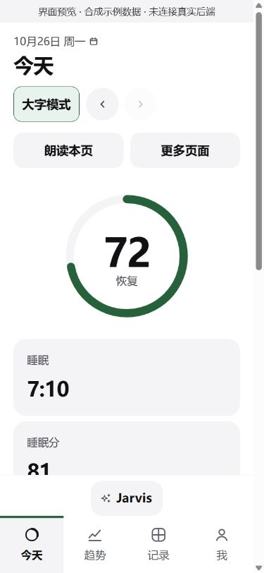
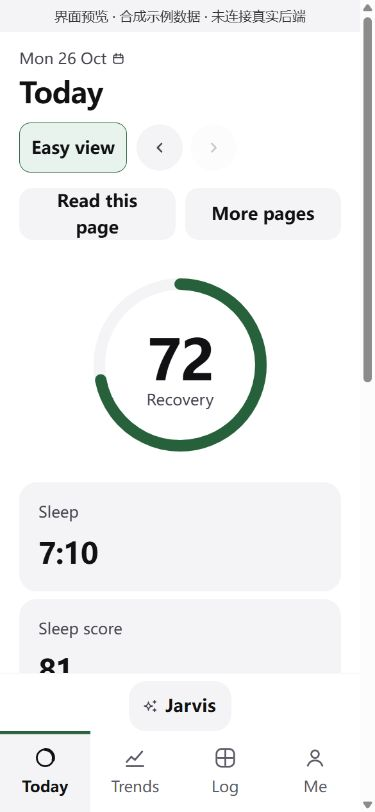
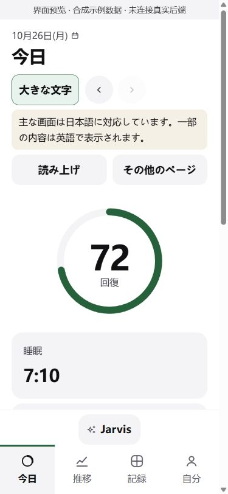

# Chinese, English and Japanese

The ElderCare fork accepts `zh`, `en` and `ja`. An empty profile setting follows the device. Chinese and English retain their existing translations. Japanese covers the shell, profile, elder view, sign-in, common health/trend labels and core native labels. Other text falls back to the existing English copy. The Japanese interface displays a notice explaining that some content remains English.

## Change the language

- Before signing in, choose **中文 / English / 日本語** on the web or native sign-in screen.
- After signing in, open **Me → Profile → Language** (自分 → プロフィール → 言語). Choose a language or follow the device, then save.
- Native choices persist in SharedPreferences and travel to the web page through the existing `lang:` bridge and `#lang=ja` fragment. Web choices use the existing profile/local-storage mechanism.
- Japanese uses `ja-JP` date/number formatting and `lang="ja"` for assistive technology. Elder-view reading selects a Japanese local voice if the device provides one.

## Server update

Apply the normal Body Engine migration command before deploying the updated app/server. Migration `850_japanese_language.sql` extends the existing profile and push-device constraints to allow `ja`; it preserves current choices and nullable device-following behavior. The API accepts `ja` in profile edits, sign-in email requests and device registration. Sign-in emails support Japanese; notification text currently uses English fallback. Existing permission checks are unchanged.

Consent documents currently exist only in Chinese and English. Japanese requests receive the **English document**, and consent records continue to store `en`, the actual document language. The consent schema is intentionally unchanged. No Japanese legal-document translation or new consent is implied. User-authored records and AI-generated text are not machine-translated by this change. The AI briefing carries the saved `ja` preference; a model's response language depends on the configured provider/prompt.

## Catalogs and loading

- Web: `web/static/i18n.js`, `i18n-en.js`, `i18n-ja.js`; under `body_engine/src/body_engine/`.
- `lang-gate.js` loads English only for English, English plus Japanese for Japanese, and neither extra catalog for Chinese. Switching with typed sign-in fields loads the catalogs without discarding input. The native offline shell inlines both catalogs; the service worker caches Japanese too.
- Native: `apps/watch2whoop/lib/src/i18n.dart` and `i18n_ja.dart`. The existing two-argument `tr(zh, en)` remains compatible; Japanese fixed labels are keyed by their English source and fall back to English when missing.
- Add translations with matching placeholders. Do not translate user records, stored identifiers or permission values. Keep missing translations visible as English rather than inventing medical or legal content.

## Verification and limits

Chinese, English and Japanese previews below use synthetic example data and are not connected to a real health backend.

| 中文 | English | 日本語 |
|---|---|---|
|  |  |  |

Added catalog/placeholder, locale, persistence/bridge, English-fallback and lazy-loading assertions, plus a profile integration check that persists `ja` and verifies the English consent response. Existing Chinese/English assertions remain enabled. Browser validation uses synthetic fixtures, not real health data. Local JavaScript checks and direct Python assertion calls do not replace the full PostgreSQL/Flutter CI suite. A new Flutter build is required for native-language changes; no local Flutter installation or cloud deployment is performed by this change.

Remaining translation work includes detailed server explanations, the consent and handbook documents, advanced training/AI screens, interpolated native messages and voice-assistant recognition. Japanese language selection is supported; this is not a claim of complete Japanese translation throughout every subsystem.
